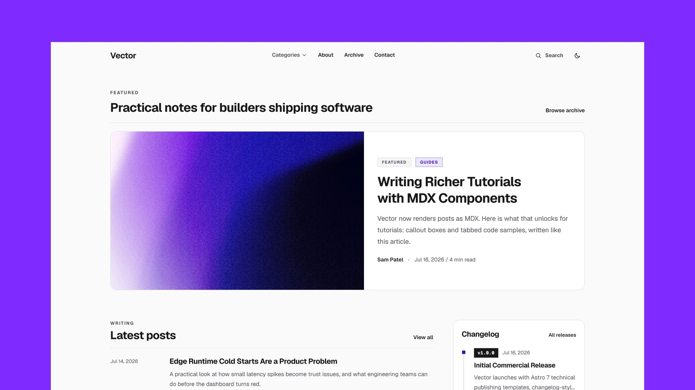

# Vector - Astro Tech Blog

[](https://vector.xocoweb.workers.dev/)

[](https://astro.build/)
[](https://tailwindcss.com/)
[](https://www.typescriptlang.org/)
[](./LICENSE)

**Live preview:** https://vector.xocoweb.workers.dev/

Vector is an Astro theme for technical publishing, engineering tutorials, deep dives, and product updates. It ships with a built-in Updates category for changelog-style release notes, an electric-violet palette with light and dark modes, softly rounded components, and an article layout with a sticky sidebar for navigation and context. Mostly static output, fast pages, crawlable articles, and easy customization.

## Features

- Editorial front page with a featured post, latest-posts list, most-read ranking, topic cards, and newsletter
- Built-in changelog: an Updates category, version-chip timeline on the homepage, and sample release note posts (`v1.0.0` to `v1.3.0`)
- Article pages with a sticky right sidebar: a table of contents that tracks the section being read, article details, tags, and share actions
- Dynamic category pages with configurable featured, grid, editorial list, and changelog layouts
- Tag, archive, article, RSS, robots, and 404 pages
- Built-in client-side search with a keyboard-friendly command palette, ranked metadata matches, and a dedicated results page
- Markdown and MDX content powered by Astro content collections, with dual light/dark syntax-highlighted code blocks (plus a copy button), styled lists, and blockquotes
- Reusable MDX content components — `Callout` (note/tip/warning/danger) and tabbed `CodeGroup` code samples — available in any post with no imports
- Frontmatter validation for titles, excerpts, categories, dates, authors, tags, images, and drafts
- Header navigation with a keyboard-accessible Categories dropdown and a matching collapsible group in the mobile menu
- Central site, navigation, social, and SEO defaults
- Canonical URLs, sitemap generation, RSS, Open Graph, Twitter/X cards, and JSON-LD
- Accessible skip link, landmarks, labels, keyboard-friendly controls, and visible focus states
- System-aware light and dark modes with a saved reader preference and tiny inline JavaScript only where needed
- Responsive Astro image handling for theme-controlled story images
- Tailwind CSS 4 tokens with no external font requests by default
- Provider-neutral newsletter configuration and static about, contact, and privacy starter pages

## Tech Stack

- Astro 7
- Tailwind CSS 4 via the Vite plugin
- Vite 8
- TypeScript
- Astro content collections
- `@astrojs/sitemap`
- `@astrojs/mdx`
- `rehype-slug`
- Sharp for image processing

## Requirements

- Node.js `22.12.0` or newer
- npm

## Getting Started

```bash
npm install
npm run dev
```

Build for production:

```bash
npm run build
```

Preview the production build locally:

```bash
npm run preview
```

## Changelog Posts

Release notes are regular posts with `category: "Updates"`. Add a `release` object with the version and type, and title the post with a version prefix such as `v1.3.0: Release Channels and Safer Rollbacks`. The homepage timeline renders the version as a chip automatically. See the sample posts in [src/content/posts](./src/content/posts) with the `vector-v` prefix.

## Customization

See [CUSTOMIZATION.md](./CUSTOMIZATION.md) for site settings, categories, newsletter, ads, images, icons, pages, and theme tokens. The default color mode is set in [src/layouts/BaseLayout.astro](./src/layouts/BaseLayout.astro).

## Content

Posts live in [src/content/posts](./src/content/posts). Each post is a folder with an `index.md` or `index.mdx` and a `cover.jpg`. Frontmatter is validated by the schema in [src/content.config.ts](./src/content.config.ts). See [CUSTOMIZATION.md](./CUSTOMIZATION.md) for the `Callout` and `CodeGroup` components available in MDX posts.

## Support

See [SUPPORT.md](./SUPPORT.md) for what is included with a license.

## License

Commercial license. See [LICENSE](./LICENSE) for complete terms.
